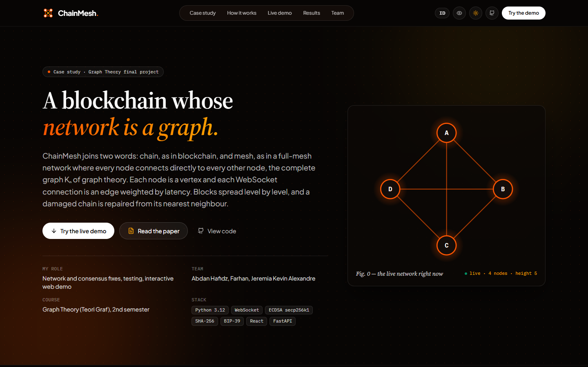
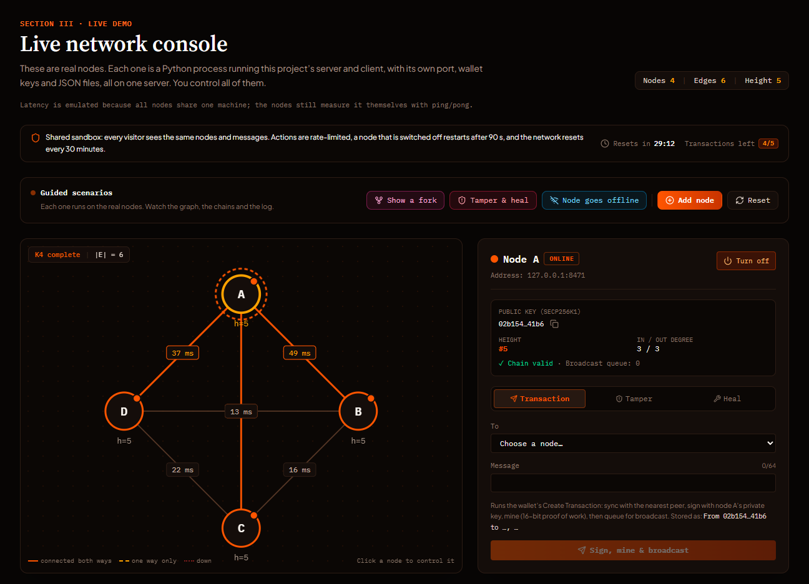
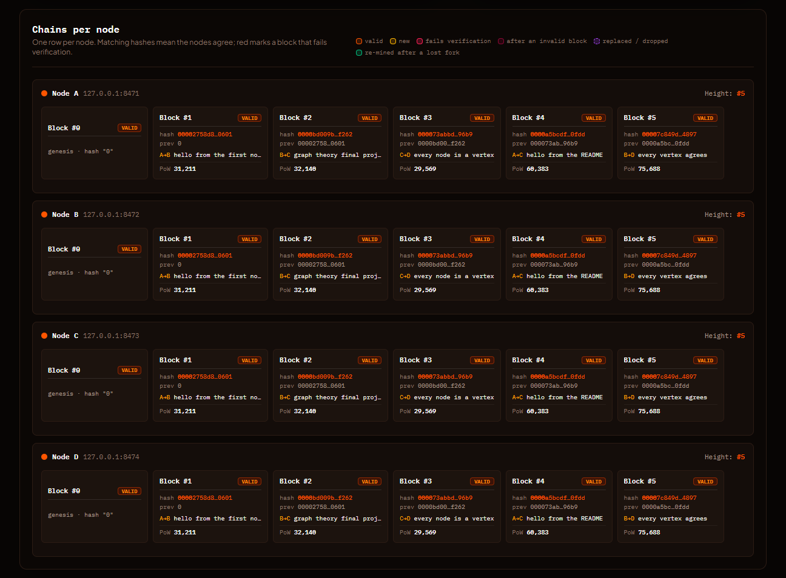

<div align="center">

# ChainMesh

**A peer-to-peer blockchain whose network is a graph.**

[Live site](https://yuujirouhanma.github.io/ChainMesh/) ·
[Theory paper (PDF)](web/public/paper/theoretical-analysis-blockchain-p2p-network.pdf) ·
[Original repository](https://github.com/abdanhafidz/blockchain-withp2p-network)

</div>



ChainMesh joins two words: *chain*, as in blockchain, and *mesh*, as in a full-mesh network where every
node connects directly to every other node, the complete graph Kₙ of graph theory.

It is the final project for the Graph Theory course (Teori Graf, 2nd semester): a Python blockchain whose
nodes talk over WebSockets, together with a paper that analyses the network with graph theory. This
repository is the working version. The code runs and follows the paper, 81 automated checks cover it,
and a web page lets anyone drive real nodes.

## Graph theory in the code

| Concept | In ChainMesh |
|---|---|
| Directed path | A chain of n blocks is a directed path with n − 1 edges: every block stores the hash of the block before it. `hash = SHA-256(message + prev_hash + signature + nonce + timeStamp)`, with a 16-bit proof of work and an ECDSA (secp256k1) signature. |
| Complete graph Kₙ | Nodes are vertices and WebSocket connections are edges. A new node needs one seed address; the `hello`/`welcome` handshake and peer exchange connect it to the other n − 1 nodes. |
| Weighted edges | Each edge is weighted by its latency, which the nodes measure with ping/pong. |
| Level-order broadcast | A new block goes to every peer at once. A node that receives a block it did not have relays it to the next level; duplicates are ignored. |
| Nearest neighbour with backtracking | A node that falls behind syncs from the online peer with the lowest latency, and moves on to the next-nearest peer when that one is offline or sends an invalid chain. |
| Fork resolution | Between forks of equal length, the block with the larger `proof_of_work` wins (paper §5; a tie goes to the smaller hash), and the losing node re-mines its own transactions on top of the winner. A longer valid chain always wins first. That rule is an addition to the paper, so one lucky block cannot cancel a longer history. |

## Live demo



The [live site](https://yuujirouhanma.github.io/ChainMesh/) has a console connected to a sandbox of 4 to 6
real node processes. Each one runs this project's server and client with its own port, keys and JSON
files. Visitors can send transactions, start a fork, tamper with a block and heal it, switch nodes off,
or add a node and watch peer exchange grow the network from K₄ to K₅.

The sandbox is shared and rate-limited. A node that is switched off restarts after 90 seconds, and the
network resets every 30 minutes. The server runs on a free plan that sleeps when nobody uses it, so the
first connection can take a minute or two. The case study and the figures work without it.



## Run it yourself

You need Python 3.12; the web page also needs Node.js 22.

**A node with the wallet menu**

```bash
pip install -r requirements.txt     # mnemonic, websockets, ecdsa
python __executer__.py              # opens three terminals: server, client and wallet
```

`__executer__.py` supports Windows, macOS and Linux with GNOME Terminal. Elsewhere, run
`__websocketserver__.py`, `__websocketclient__.py` and `__main__.py` in three terminals. To join a node on
the same network, pass its address: `python __executer__.py --peer 192.168.1.10`. To run several nodes on
one machine, see [PERBAIKAN.md](PERBAIKAN.md#cara-menjalankan) (in Indonesian).

**The web demo**

```bash
pip install -r demo/requirements.txt
cd web && npm ci && npm run build && cd ..
python -m demo                      # then open http://127.0.0.1:8450
```

Settings and deployment are described in [demo/README.md](demo/README.md).

**Tests**

```bash
python tests/run_all.py
```

The suite runs 81 checks:

- 42 unit checks: wallet and seed, mining, proof of work, tamper detection, fork rules, chain repair.
- 1 concurrency check.
- 14 checks of the wallet menus and the launcher.
- 24 checks with three real nodes on ports 8341–8343: the complete graph, broadcast, forks, repair, and a node catching up.

Test data is written to a temporary folder, so your own wallet is never touched.

## Repository layout

```
Config.py               ports, difficulty and data folders, all overridable by environment variables
Models/                 blocks and chains: verification, fork rules, chain repair
Middleware/             hashing and proof of work, ECDSA keys, BIP-39 seed, JSON storage, chain sync
Network/                WebSocket server and client, handshake and peer exchange, latency
Controller/ View/ Loader/   the wallet menu
Database/ Buffer/       JSON storage templates (the wallet file stays local and is git-ignored)
demo/                   FastAPI sandbox that runs real nodes for the web page
web/                    the site: React, Vite and Tailwind, in English and Indonesian
tests/                  the 81 automated checks
```

## Limitations

This is a teaching project, not a wallet for real assets.

- Private keys are stored unencrypted in `Database/NodeDB.json`.
- `proof_of_work` grows with the nonce, so a miner can inflate it by starting from a large nonce. The
  longest-chain rule limits the damage; real blockchains compare accumulated difficulty instead.

## Credits

- **Abdan Hafidz** ([abdanhafidz](https://github.com/abdanhafidz)): original architecture and code,
  author of the theoretical analysis paper.
- **Farhan** ([farhanwew](https://github.com/farhanwew)): contributor.
- **Jeremia Kevin Alexandre** ([YuujirouHanma](https://github.com/YuujirouHanma)): network and consensus
  fixes, testing, interactive web demo.

The original code and the paper are in
[abdanhafidz/blockchain-withp2p-network](https://github.com/abdanhafidz/blockchain-withp2p-network).
[PERBAIKAN.md](PERBAIKAN.md) (in Indonesian) lists every fix and maps the code to each section of the paper.

## Ringkasan (Bahasa Indonesia)

ChainMesh adalah tugas akhir mata kuliah Teori Graf: blockchain Python dengan jaringan peer-to-peer
WebSocket yang dimodelkan sebagai complete graph Kₙ. Setiap node adalah vertex, setiap koneksi adalah edge
berbobot latency, blok disebarkan secara level-order, dan node yang tertinggal menyinkronkan chain dari
tetangga terdekat dengan backtracking. Daftar perbaikan dan kesesuaiannya dengan paper ada di
[PERBAIKAN.md](PERBAIKAN.md). Cara menjalankan dan men-deploy demo web ada di
[demo/README.md](demo/README.md). Situs live tersedia dalam bahasa Inggris dan Indonesia:
https://yuujirouhanma.github.io/ChainMesh/
